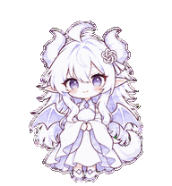

# Codex娘

白发紫瞳、龙角、小翅膀与尾巴的大头 Q 版动画宠物。简化了花纹、流苏与配饰，让小尺寸下的表情更清楚。

## 素材

- [精灵图](assets/spritesheet.png)：透明 PNG，支持 v2 布局的 Pets 上传接口使用。
- [高清主造型](assets/main-look.png)：角色参考图。
- [完整动画预览](previews/all-states.gif) · [MP4](previews/all-states.mp4)
- [跳跃衔接](previews/idle-jump-idle.gif) · [视线循环](previews/look-loop.gif)

## 动作

包含眨眼待机、左右移动、招手、跳跃、惊讶失落、托腮等待、手柄工作、读书检查九种状态，以及十六个视线方向。

精灵图为 **1536×2288**，8 列、11 行，单帧 **192×208**，共 73 个有效帧。每行帧数为 `6,8,8,4,5,8,6,6,6,8,8`，其余单元透明。具体布局见 [layout.json](layout.json)。

## 使用

Windows 用户可前往 [最新 Release](https://github.com/daguoguoha/white-dragon-pet/releases/latest)，下载 `Codex-Girl-v1.0.0-Windows.zip`，完整解压后双击 `Install.cmd`。安装后在桌面端的 **设置 → 宠物 → 刷新** 中选择 **Codex娘**。需要支持 v2 自定义宠物的桌面端；本地安装不自动同步到网页账户。详见 [安装说明](install/README.md)。

下载 `assets/spritesheet.png`，通过支持上述 v2 格式的宠物创建或更新工具导入。`assets/main-look.png` 是参考原画，不是可直接导入的精灵图。

## 检查与已知差异

素材已通过布局、透明背景、必需帧、跳跃落点和视线方向检查。少数近轴向眼神较细微；左半视线帧约小 6%，外轮廓略浅，循环时可见轻微姿态变化。

角色与动作由 imagegen 根据用户提供的参考图重新生成，再完成精灵图合成与检查。
